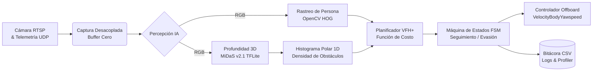

# Sistema Autónomo de Evasión de Postes y Árboles para DJI Air 2S 🚁

[](https://www.python.org/)
[](https://mavsdk.mavlink.io/)
[](https://opencv.org/)
[](https://www.tensorflow.org/lite)
[]()

Proyecto de Tesis de Ingeniería de Sistemas para la navegación reactiva, seguimiento de objetivos y evasión autónoma de obstáculos aéreos (postes de luz, cableado y árboles) en entornos urbanos densos mediante visión monocular y computación en el borde (*Edge Computing*).

---

## 📑 Documentación Académica y Metodológica (Taller de Inv. - Glen Rodríguez)

En cumplimiento estricto con los lineamientos metodológicos de la **Semana 07 (Inicio de la Implementación)**, se dispone de la siguiente documentación detallada:

* 🗺️ **[Plan de Implementación Incremental](docs/PLAN_IMPLEMENTACION.md):** Descomposición modular estricta (Entradas, Procesamiento, Salidas), cronograma de 3 hitos de avance y métricas técnicas.
* 🛡️ **[Matriz de Gestión de Riesgos y Mitigación](docs/MATRIZ_RIESGOS.md):** Análisis de riesgos técnicos, metodológicos, de gestión y cognitivos conforme a las diapositivas 5 a 8.
* 📦 **Bitácoras de Prototipos por Versión:**
  - **[Prototipo v0.1 (README)](docs/prototipos/v0.1_README.md):** Pipeline base *Sense-Plan-Act*, normalización de tensores y modelado VFH+.
  - **[Prototipo v0.2 (README)](docs/prototipos/v0.2_README.md):** Acoplamiento físico Air 2S + RosettaDrone + MAVSDK, despegue automático y resolución de bloqueos WDAC/OpenCV.
  - **[Prototipo v0.3 (README)](docs/prototipos/v0.3_README.md):** Máquina de Estados Finitos (FSM), HUD interactivo, telemetría y diagnósticos de red.

---

## 🏗️ Arquitectura del Sistema (Puente Hardware-Software)

Dado que el **DJI Air 2S** es una plataforma cerrada que no admite la carga de scripts propios, se desarrolló una arquitectura de red inalámbrica en puente:

1. **Plataforma Aérea:** Dron DJI Air 2S con transmisión por radio OcuSync hacia el control remoto físico.
2. **Puente Móvil (Android):** Tablet/Teléfono conectado por USB al mando, ejecutando **RosettaDrone** para traducir el SDK nativo de DJI a paquetes universales **MAVLink (UDP 19980)** y video H.264 a **RTSP (puerto 8554)**.
3. **Estación de Procesamiento (Laptop):** Computadora en tierra procesando en tiempo real el pipeline de IA y enviando vectores de velocidad en modo *Offboard* vía **MAVSDK**.

```
[DJI Air 2S] <== Radio OcuSync ==> [Control Remoto] <== USB ==> [Tablet RosettaDrone]
                                                                        ||
                                                              (Wi-Fi UDP / RTSP)
                                                                        ||
                                                                        \/
                                                       [Laptop: Pipeline Python]
                                                       (MiDaS + HOG + VFH+ + FSM)
```

---

## 🧠 Pipeline de Procesamiento (Sense-Plan-Act)



### Máquina de Estados Finitos (FSM)
El dron implementa una FSM determinista para garantizar que el seguimiento de la persona se reanude fluidamente tras una maniobra de escape:
* **`BUSQUEDA`:** Si la persona sale del campo de visión, el dron entra en espera o giro controlado.
* **`SEGUIMIENTO`:** Condición nominal con camino frontal despejado; el dron se orienta y avanza hacia la persona.
* **`EVASION`:** Se activa prioritariamente si la distancia mínima al obstáculo es menor a $1.5\text{ m}$ o si el ángulo VFH+ diverge $> 8^\circ$.
* **`REANUDANDO`:** Transición suave post-evasión que realinea la cámara con el objetivo antes de volver a seguimiento nominal ($|\theta_{evasion} - \theta_{objetivo}| \le 3^\circ$).

---

## 📊 Matriz de Versiones y Prototipos

| Versión | Hito / Descripción | Estado | Bitácora Técnica |
| :---: | :--- | :---: | :---: |
| **`v0.1`** | Diseño modular del pipeline, VFH+ inicial y corrección de disparidad monocular. | Completado | [Ver Bitácora v0.1](docs/prototipos/v0.1_README.md) |
| **`v0.2`** | Integración física con DJI Air 2S, MAVSDK 3.17, bypass de WDAC con HOG y despegue probado. | Completado | [Ver Bitácora v0.2](docs/prototipos/v0.2_README.md) |
| **`v0.3`** | Implementación de FSM, logging de métricas para tesis a 30 Hz y script de diagnóstico RTSP. | **En curso / Actual** | [Ver Bitácora v0.3](docs/prototipos/v0.3_README.md) |
| **`v1.0`** | Fine-tuning con dataset urbano de postes/árboles (IDD) y validación en exteriores. | Planificado | - |

---

## 🛠️ Reproducibilidad del Entorno

Para replicar exactamente los experimentos y evitar conflictos de compatibilidad de librerías:

```bash
# 1. Clonar el repositorio
git clone https://github.com/Gus7Ghost/Tesis-Evasion-Air2S.git
cd Tesis-Evasion-Air2S

# 2. Crear y activar entorno virtual
python -m venv venv
# En Windows PowerShell:
.\venv\Scripts\Activate.ps1

# 3. Instalar dependencias congeladas
pip install -r requirements.txt
```

### Modelos requeridos en `/models`:
- `midas_v21_small_256.tflite` (Colocar en la carpeta `models/`).

### Configuración de Red en `config.yaml`:
```yaml
network:
  mavsdk_connection: "udp://:19980"           # Puerto donde RosettaDrone envía telemetría
  video_stream_uri: "rtsp://192.168.43.54:8554/fpv" # IP de la Tablet con RosettaDrone
```

### Ejecución:
* **Prueba aislada de cámara (Sin motores):**
  ```bash
  python test_video.py
  ```
* **Bucle completo de vuelo autónomo:**
  ```bash
  python main.py
  ```
