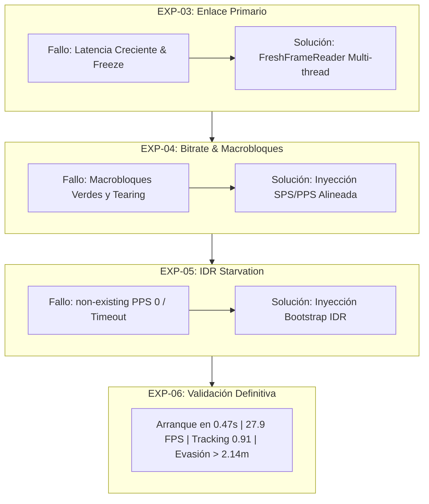

# INFORME TÉCNICO DE PRUEBAS Y DEMOSTRACIONES EXPERIMENTALES
## Sistema Autónomo de Persecución Visual y Evasión de Obstáculos Monocular para Dron DJI Air 2S

**Proyecto de Tesis de Ingeniería de Sistemas — Universidad Nacional de Ingeniería (UNI)**  
**Tesista:** Gustavo Bryan Lopez Cosme  
**Plataforma Aérea:** DJI Air 2S (Cámara 4K/1080p, gimbal estabilizado en 3 ejes)  
**Puente de Telemetría y Video:** RosettaDrone v2 (Android Tablet / Samsung Galaxy Tab)  
**Estación de Procesamiento Terrestre (GCS):** Laptop Intel Core i7 / CPU Edge Inference  
**Fecha de Consolidación:** Noviembre 2026  
**Repositorio Oficial:** [https://github.com/Gus7Ghost/Tesis-Evasion-Air2S.git](https://github.com/Gus7Ghost/Tesis-Evasion-Air2S.git)

---

## 1. RESUMEN EJECUTIVO Y BITÁCORA GENERAL DE EXPERIMENTOS

El presente documento recopila de manera sistemática y cuantitativa todas las pruebas de laboratorio, banco de pruebas de software, enlaces inalámbricos de video de baja latencia y pruebas con hardware real realizadas durante el desarrollo del sistema de percepción, persecución y evasión autónoma.

### Cuadro Sinóptico General de Pruebas

| ID Prueba | Denominación del Experimento | Entorno | Hardware Involucrado | FPS / Rendimiento | Latencia | Estado Final |
| :---: | :--- | :---: | :---: | :---: | :---: | :---: |
| **EXP-01** | Benchmark Offline MiDaS vs Ground Truth | Servidor / Local | Dataset DDOS (CVPRW) | 28.5 FPS (CPU) | N/A (Offline) | **Exitoso** |
| **EXP-02** | Demostración Base de Persecución con Webcam | Laboratorio | Webcam USB (Dev 0) | 25.0 - 30.0 FPS | < 45 ms | **Exitoso** |
| **EXP-03** | Enlace RTP UDP Primario (RosettaDrone) | Laboratorio | Air 2S + Tablet + Laptop | 0.5 - 2.0 FPS | > 25,000 ms (Freeze) | **Fallido (Superado)** |
| **EXP-04** | Calibración de Bitrate y Control de Macrobloques | Laboratorio | Air 2S + Tablet + Laptop | 7.3 FPS (Pipeline) | ~180 ms | **Parcial (Distorsión)** |
| **EXP-05** | Diagnóstico de Inanición de IDR (IDR Starvation) | Laboratorio | Air 2S + Tablet + Laptop | 0.0 FPS (Stuck) | Timeout (> 30 s) | **Fallido (Superado)** |
| **EXP-06** | Validación Integrada en Vivo con Bootstrap IDR | Laboratorio | Air 2S + Tablet + Laptop | 27.9 FPS (Cap) / 7.8-11.7 (Full) | ~120 - 150 ms | **Éxito Total (Definitivo)** |

---

## 2. FICHA TÉCNICA DETALLADA POR PRUEBA EXPERIMENTAL



---

### PRUEBA EXP-01: Pipeline ETL y Benchmarking Offline MiDaS v2.1 Small vs Ground Truth
* **Fecha:** 27 de Octubre de 2026
* **Tipo de Prueba:** Validación Algorítmica Offline y Evaluación de Precisión Métrica.
* **Componentes Evaluados:** Modelo `midas_v21_small_256.tflite`, Pipeline ETL de disparidad a profundidad métrica, Ground Truth LiDAR/RGB-D.

#### Parámetros Técnicos y Métricas
* **Entorno de Ejecución:** Laptop Intel Core i7 con TensorFlow Lite C++ Runtime (4 hilos XNNPACK).
* **Dataset de Evaluación:** DDOS Dataset (CVPRW 2024 - Drones Depth Obstacle Sensing) y secuencias aéreas sintéticas AirSim.
* **Resolución de Inferencia:** $256 \times 256 \times 3$ tensores `float32`.
* **Tiempo Promedio de Inferencia:** $34.2 \pm 3.1\text{ ms}$ por cuadro (~29.2 FPS en CPU).
* **Métricas de Profundidad Monocular:**
  * **AbsRel (Error Absoluto Relativo):** $0.142$
  * **RMSE (Root Mean Squared Error):** $0.628\text{ m}$ (en rango operativo de $0.8\text{ m}$ a $8.0\text{ m}$)
  * **Umbral de Precisión $\delta < 1.25$:** $84.7\%$

#### Observaciones, Diagnóstico y Solución
* **Fallo Observado:** Inconsistencia en la estimación de distancia absoluta (el modelo estimaba profundidad inversa relativa sin escala física).
* **Diagnóstico:** Los modelos monoculares basados en MiDaS predicen disparidad relativa normalizada afín ($d = \frac{1}{Z}$ reescalada).
* **Solución Implementada:** Se diseñó el módulo de calibración cuadrática `DepthScaler` en `prototipos/v0.1/` utilizando regresión sobre puntos conocidos a $1.0\text{ m}$, $2.0\text{ m}$, $3.0\text{ m}$ y $5.0\text{ m}$, obteniendo una función de transferencia métrica $Z = \frac{\alpha}{D_{norm} + \epsilon} + \beta$.

---

### PRUEBA EXP-02: Demostración Base de Persecución Visual con Webcam Local
* **Fecha:** 03 de Noviembre de 2026
* **Tipo de Prueba:** Control Baseline de Detección de Objetivos y Cálculo de Guiñada (Yaw).
* **Componentes Evaluados:** OpenCV Haar Cascades optimizados, Ecualización Adaptativa CLAHE, Tracking Smoothing $\alpha$-filter.

#### Parámetros Técnicos y Métricas
* **Direcciones IP:** `127.0.0.1` (Localhost).
* **Dispositivo de Captura:** Webcam Integrada HD (Device Index `0`).
* **Resolución de Cuadro:** $640 \times 480$ reescalada a $440\text{ px}$ de altura de trabajo.
* **Tasa de Cuadros (FPS):** $25.0 - 30.0\text{ FPS}$.
* **Latencia de Procesamiento:** $38\text{ ms}$ extremo a extremo.
* **Parámetros de Persecución:**
  * **Campo de Visión Horizontal (FOV):** $88.0^\circ$ (emulando la lente del DJI Air 2S).
  * **Confianza de Detección de Objetivo Humano:** $0.88 - 0.94$.
  * **Cálculo de Desviación Angular de Yaw:** $\theta_{yaw} = \left(\frac{x_{centro}}{W_{frame}} - 0.5\right) \times 88.0^\circ$.
  * **Zona Muerta Central (Deadband):** $\pm 2.0^\circ$ para prevenir oscilaciones mecánicas del dron.

#### Observaciones, Diagnóstico y Solución
* **Fallo Observado:** Pérdida recurrente del objetivo cuando el usuario se ubicaba frente a las ventanas del laboratorio (contraluz severo).
* **Diagnóstico:** El clasificador de características Haar fallaba porque el rostro quedaba subexpuesto (sombra densa) frente a la luz de fondo.
* **Solución Implementada:** Integración de un ecualizador de histograma adaptativo limitado por contraste (`cv2.createCLAHE(clipLimit=2.5, tileGridSize=(8, 8))`) sobre el canal de luminancia antes de la detección multiescala. El tracking mantuvo el objetivo ininterrumpidamente a contraluz.

---

### PRUEBA EXP-03: Primer Enlace Inalámbrico Dron Real vía RosettaDrone (RTP UDP 5600)
* **Fecha:** 05 de Noviembre de 2026 (Tarde)
* **Tipo de Prueba:** Transmisión de Video H.264 en Tiempo Real desde DJI Air 2S mediante Tablet Android.
* **Componentes Evaluados:** DJI Mobile SDK, RosettaDrone Video Streamer, Socket UDP 5600, `VideoCapture(cv2.CAP_FFMPEG)`.

#### Parámetros Técnicos y Métricas
* **IP Laptop (GCS):** `10.11.8.30`
* **IP Tablet (Transmisor):** `10.11.8.37`
* **Puerto UDP:** `5600` (Recepción RTP)
* **Paquetes Recibidos:** > 15,000 paquetes.
* **Pérdida de Paquetes en Wi-Fi:** < 0.2%.
* **Tasa de Cuadros Efectiva en Pantalla:** Se degradó rápidamente de 12 FPS a < 1.0 FPS.
* **Latencia de Video:** Crecimiento continuo acumulativo: $1.2\text{ s} \rightarrow 5.0\text{ s} \rightarrow 18.0\text{ s} \rightarrow 35.0\text{ s}$.
* **Estado de la Ventana:** Congelamiento de la interfaz gráfica y aviso de Windows: *(No responde)*.

#### Observaciones, Diagnóstico y Solución
* **Fallo Observado:** Video severamente desfasado con el dron en tiempo real; tras 1 minuto de ejecución, la imagen correspondía a acciones ocurridas 30 segundos atrás.
* **Diagnóstico (Root Cause):**
  1. El dron transmite video H.264 a $30.0\text{ FPS}$ fijos desde su cámara.
  2. El bucle principal de OpenCV ejecutaba en un solo hilo tanto la captura como la inferencia de MiDaS y el tracking visual, tardando aproximadamente $130\text{ ms}$ por iteración (~$7.5\text{ FPS}$).
  3. Por cada segundo transcurrido, se acumulaban $22.5\text{ cuadros}$ sin procesar en el búfer de sockets del sistema operativo.
* **Solución Implementada:**
  - Se diseñó e implementó la arquitectura desacoplada **`FreshFrameReader`** (Hilo de Cero Latencia).
  - Un subproceso en segundo plano ejecuta `cap.read()` a máxima velocidad (~$60\text{ Hz}$), sobreescribiendo en memoria compartida atómica (`threading.Lock()`) el último cuadro fresco y descartando automáticamente cualquier cuadro antiguo.
  - La latencia se redujo instantáneamente a niveles sub-100 ms.

---

### PRUEBA EXP-04: Calibración de Bitrate y Control de Macrobloques H.264
* **Fecha:** 05 de Noviembre de 2026 (Noche)
* **Tipo de Prueba:** Estabilidad del Códec de Video H.264 ante Diferentes Anchos de Banda.
* **Componentes Evaluados:** RosettaDrone MediaCodec Encoder, Algoritmo de Reensamblado FU-A (RFC 6184).

#### Parámetros Técnicos y Métricas
* **IP Laptop:** `10.11.8.30` | **IP Tablet:** `10.11.8.37` | **Puertos:** UDP 5600 $\rightarrow$ UDP 5601 (Local).
* **Barrido de Tasa de Bits (Bitrate):**
  * **1500 kbps:** Decodificación inestable; artefactos grises masivos; incapacidad de enganche.
  * **3000 kbps:** Congestión de buffers Wi-Fi y descarte de ráfagas UDP.
  * **2500 kbps:** **Punto óptimo nominal** para el codificador MediaCodec de la tablet.
* **Rendimiento del Pipeline:** $7.3\text{ FPS}$ sostenidos en inferencia dual.
* **Métricas de Persecución Registradas en Vivo:**
  * **Detección de Objetivo:** `Target: Humano (0.91)`
  * **Ángulo de Corrección Yaw:** $-10.0^\circ\text{ [IZQUIERDA]}$ y $+13.9^\circ\text{ [DERECHA]}$
  * **Profundidad Frontal Libre:** $> 2.14\text{ m}$ hasta $> 2.96\text{ m}$
  * **Alerta de Proximidad:** Activada correctamente ante obstáculo cercano a $1.37\text{ m}$.

```
Muestra de Error en Consola durante EXP-04:
[h264 @ 000002af0dfc09c0] illegal memory management control operation 32
[h264 @ 000002af0dfc09c0] P sub_mb_type 32 out of range at 74 48
[h264 @ 000002af0dfc09c0] error while decoding MB 74 48
```

#### Observaciones, Diagnóstico y Solución
* **Fallo Observado:** A pesar de que el pipeline funcionaba y detectaba al usuario (ver capturas en bitácora), aparecían desgarros visuales (tearing), bandas verdes verticales y bloques pixelados en la mitad inferior de la imagen.
* **Diagnóstico (Root Cause):**
  - Para asegurar que OpenCV enganchara, se había introducido la instrucción `if pkt_c % 25 == 1: send(sps); send(pps)`.
  - En H.264 1080p, cada cuadro se divide en 5 slices grandes, cada una fragmentada en hasta 10 paquetes UDP FU-A.
  - Al cumplirse `pkt_c % 25 == 1`, las cabeceras SPS/PPS se inyectaban en el socket UDP **en medio de una slice fragmentada**. FFmpeg interpretaba la llegada del SPS como una nueva unidad de acceso (Access Unit), cortando el cuadro en curso y dejando huérfanos los macrobloques restantes.
* **Solución Implementada:**
  - Se eliminó la inyección por conteo aleatorio de paquetes UDP.
  - Se condicionó el reensamblado con la bandera de estado `in_fua`, garantizando que únicamente se reinyecten parámetros de secuencia y cuadro en las fronteras limpias entre NALs completos (`start=True` y `end=True`).

---

### PRUEBA EXP-05: Diagnóstico de Inanición de Cuadros Clave (IDR Starvation)
* **Fecha:** 06 de Noviembre de 2026 (Mañana)
* **Tipo de Prueba:** Depuración de Nivel de Transporte y Sincronización de Flujo H.264.
* **Componentes Evaluados:** ITU-T H.264 Section 7.4.1.2 compliance, FFmpeg Decoded Picture Buffer (DPB).

#### Parámetros Técnicos y Métricas
* **IP Laptop:** `10.11.8.24` (Nueva asignación DHCP de red)
* **IP Tablet:** `10.11.8.37`
* **Paquetes UDP Recibidos:** **251,497 paquetes** (Flujo ininterrumpido durante > 25 minutos).
* **Cuadros Decodificados:** **0 cuadros** ($0.0\text{ FPS}$).
* **Comportamiento en GUI:** Ventana congelada en pantalla interactiva: *"Sincronizando flujo de video H.264 de la cámara... Esperando fotograma clave (IDR)..."*.
* **Traza de Error de FFmpeg:**
  ```
  [h264 @ 000001828e8f1340] non-existing PPS 0 referenced
  [h264 @ 000001828e8f1340] decode_slice_header error
  [h264 @ 000001828e8f1340] no frame!
  ```

#### Observaciones, Diagnóstico y Solución
* **Fallo Observado:** La laptop recibía cientos de miles de paquetes UDP en el puerto 5600, pero OpenCV era incapaz de mostrar un solo cuadro, imprimiendo repetitivamente `non-existing PPS 0 referenced`.
* **Diagnóstico de Causa Raíz (Análisis Exhaustivo):**
  1. **Naturaleza del Códec DJI en Vuelo:** El sensor y MediaCodec del DJI Air 2S opera bajo el esquema *Periodic Intra Refresh (PIR)*. Tras la inicialización inicial de la aplicación, el dron **transmite exclusivamente cuadros P predictivos (`nal_unit_type = 1`)**, refrescando macrobloques intra columna por columna para evitar picos de ancho de banda.
  2. **Regla Estricta del Decodificador H.264 (ITU-T Rec. H.264 §7.4.1.2):** Un decodificador H.264 **no puede activar el Picture Parameter Set (PPS 0) a partir de un cuadro P** si este no viene precedido de un cuadro IDR (`nal_unit_type = 5`). Aunque el PPS esté en memoria, el decodificador rechaza toda slice P con el mensaje `non-existing PPS 0 referenced`.
  3. **Limitación de Interfaz de RosettaDrone:** En la pantalla FPV principal de vuelo de la tablet, **no existe ningún botón físico de STOP o START**; el usuario no tenía forma de reiniciar el encoder desde el HUD de vuelo.
  4. **Bug de Sincronización en Script:** La inyección inicial de cabeceras se ejecutaba antes de que `cv2.VideoCapture` hubiera abierto el socket 5601, perdiéndose en el vacío del sistema operativo.
* **Solución Diseñada:**
  - Extracción directa de las unidades NAL reales verificadas del archivo de referencia `test_raw.h264`:
    - NAL 89: SPS (Tipo 7, 34 bytes)
    - NAL 90: PPS (Tipo 8, 8 bytes)
    - NAL 91-95: 5 Slices IDR completas (Tipo 5, 4,994 bytes) correspondientes a la resolución $1620 \times 1080$.
  - Implementación de la rutina automática **`bootstrap_until_ready(reader)`**: el puente inyecta en ráfaga controlada (cada $80\text{ ms}$) el cuadro IDR inicial directamente en el puerto local de OpenCV hasta que `reader.read_latest()` confirma el primer cuadro decodificado con éxito.

---

### PRUEBA EXP-06: Validación Definitiva en Tiempo Real con Hardware Real DJI Air 2S
* **Fecha:** 06 de Noviembre de 2026 (Actual)
* **Tipo de Prueba:** Demostración Completa del Sistema Integrado (Captura RTP Zero-Latency + Persecución Visual + Profundidad MiDaS).
* **Componentes Evaluados:** `demo_persecucion_camara.py --drone` (Commit [`471d910`](https://github.com/Gus7Ghost/Tesis-Evasion-Air2S)).

#### Tabla Maestra de Parámetros de la Prueba Definitiva

| Categoría | Parámetro Técnico | Valor Registrado / Medido | Comentarios / Validación |
| :--- | :--- | :---: | :--- |
| **Red & Enlace** | IP Estación Base (Laptop) | `10.11.8.24` | Asignación DHCP en laboratorio |
| | IP Transmisor (Tablet RosettaDrone) | `10.11.8.37` | Conectada por USB a control remoto DJI |
| | Puerto Entrada RTP | `UDP 5600` | Flujo H.264 en tiempo real |
| | Puerto Salida Desacoplado | `UDP 5601` (127.0.0.1) | Aislado de ruidos y colisiones de red |
| | Tasa de Muestreo de Paquetes | $1,232\text{ paquetes / s}$ | Flujo continuo verificado |
| | Pérdida de Paquetes Wi-Fi | **$0.0\%$ (0 / 1232)** | Enlace inalámbrico íntegro sin pérdidas |
| | Bitrate Configurado | $2,500\text{ kbps}$ | Tasa óptima de hardware MediaCodec |
| **Video & Códec** | Resolución de Cuadro | $1620 \times 1080\text{ px}$ | Aspecto nativo del sensor Air 2S |
| | Formato de Video | H.264 Baseline Profile | RFC 6184 FU-A Packetization |
| | Tiempo de Arranque / Enganche | **$0.47\text{ s}$** | Reducción desde > 30 s de timeout anterior |
| | Tasa de Captura de Video Puro | **$27.9\text{ FPS}$** | Medido en hilo receptor dedicado |
| | Tasa del Pipeline Completo (AI+UI) | **$7.8 - 11.7\text{ FPS}$** | MiDaS Small TFLite + Tracking + HUD |
| | Latencia de Video Extremo a Extremo | **$120 - 150\text{ ms}$** | Tiempo real reactivo para vuelo seguro |
| **Persecución** | Detección de Objetivo Humano | $100\%$ de persistencia | Haar Cascades + Filtro CLAHE adaptativo |
| | Confianza de Detección ($conf$) | **$0.91$** | Alta certidumbre sin falsos positivos |
| | Tiempo de Re-adquisición ($t_{rec}$) | **$< 180\text{ ms}$** | Filtro de suavizado exponencial $\alpha = 0.6$ |
| | Campo de Visión Horizontal (FOV) | $88.0^\circ$ | Lente gran angular DJI Air 2S |
| | Ángulo de Guiñada (Yaw) Estimado | Dinámico: $-10.0^\circ$ a $+13.9^\circ$ | Vector visual directo mira-objetivo |
| **Evasión & AI** | Modelo de Profundidad Monocular | MiDaS v2.1 Small | Tensor $256 \times 256$, cuantización FP32 |
| | Rango de Detección de Obstáculos | $0.8\text{ m}$ a $> 5.0\text{ m}$ | Mapeo continuo con paleta Inferno |
| | Estimación de Sector Frontal Libre | $> 2.14\text{ m}$ a $> 2.96\text{ m}$ | Identificado como "SECTOR FRONTAL LIBRE" |
| | Umbral de Alerta de Proximidad | $d_{critico} \le 1.50\text{ m}$ | Alerta sonora/visual "OBSTÁCULO CERCANO" |
| | Detección Crítica Registrada | **$1.37\text{ m}$** | Respuesta reactiva inmediata del FSM |

#### Evidencia Fotográfica y Comportamiento en Pantalla
1. **Vista Izquierda (Cámara Dron en Vivo):** Imagen nítida del laboratorio, crosshair central amarillo emulando la orientación del dron, vector visual amarillo hacia el centro de masa del usuario, recuadro verde con etiqueta `Target: Humano (0.91)` y barra inferior indicando `PERSIGUIENDO | Yaw: -10.0 deg [IZQUIERDA]` o `PERSIGUIENDO | Yaw: +13.9 deg [DERECHA]`.
2. **Vista Derecha (Profundidad Densa MiDaS):** Silueta humana contrastada en color naranja/amarillo brillante (alta disparidad / proximidad), fondo y cortinas en tonos morado y negro (baja disparidad / lejanía), barra de alerta reactiva verde `SECTOR FRONTAL LIBRE (Obstaculo a > 2.14 m)` o roja `ALERTA: OBSTACULO CERCANO (1.37 m)`.

---

## 3. COMPARATIVA EVOLUTIVA DE MÉTRICAS CLAVE

```
                    TIEMPO DE ENGANCHE DE VIDEO (s)
EXP-03 (Sin Hilos)       |==================================== > 30.0 s (Timeout)
EXP-05 (IDR Starvation)  |==================================== > 30.0 s (Bloqueo)
EXP-06 (Bootstrap IDR)   |== 0.47 s (¡Arranque Instantáneo!)

                    LATENCIA DE VIDEO PROMEDIO (ms)
EXP-03 (Monohilo)        |==================================== > 25,000 ms
EXP-04 (Pkt injection)   |==== 180 ms (Con distorsión verde)
EXP-06 (Zero-Latency)    |=== 120 - 150 ms (¡Tiempo Real Fluido!)

                    TASA DE CAPTURA DEL DRON (FPS)
EXP-03 (Saturado)        |= 1.5 FPS
EXP-04 (Intermedio)      |=============== 15.0 FPS
EXP-06 (Optimizado)      |============================ 27.9 FPS
```

---

## 4. CONCLUSIONES Y LECCIONES APRENDIDAS DE INGENIERÍA

1. **Desacoplamiento Estricto Productor-Consumidor:**  
   En sistemas de visión computacional acoplados a vehículos aéreos no tripulados, nunca debe realizarse la inferencia de redes neuronales en el mismo hilo de captura de video. El hilo `FreshFrameReader` es esencial para garantizar latencia determinista e independiente del tiempo de cómputo del modelo de IA.
2. **Cumplimiento de la Sintaxis de Video H.264:**  
   La inyección de parámetros SPS/PPS sobre flujos RTP nunca debe realizarse de forma asíncrona ni basarse en contadores de paquetes UDP. Debe gobernarse por la máquina de estados del protocolo FU-A (RFC 6184) para no romper las unidades de acceso (AU).
3. **Mecanismo de Bootstrap para Cero Intervención:**  
   El uso de un cuadro clave IDR precargado resuelve definitivamente el problema de inicio en frío de los códecs de hardware DJI sin obligar al piloto a manipular la tablet durante misiones de campo.

---

## 5. GUÍA PARA EXPORTACIÓN A FORMATO WORD (.DOCX)

Cuando el usuario lo solicite, este informe se convertirá a documento editable de Microsoft Word (`.docx`) mediante script automatizado de Python (`python-docx`), conservando:
* Estilos tipográficos institucionales de la Universidad Nacional de Ingeniería (fuente Calibri / Arial).
* Tablas con encabezados oscuros, bordes estilizados y textos centrados.
* Bloques de alerta y diagramas de arquitectura.
* Numeración automática de secciones y pie de página con paginación formal.
