# Plan de Implementación Incremental
**Taller de Investigación - Docente: Glen Rodríguez (Semana 07)**

Este documento estructura el plan de ejecución de la tesis respondiendo a los lineamientos metodológicos de la asignatura: descomposición modular (Entradas, Procesamiento, Salidas), gestión de hitos incrementales y definición rigurosa de métricas.

---

## 1. Descomposición Modular del Sistema (Slide 2)

```mermaid
flowchart LR
    subgraph ENTRADAS [1. Entradas]
        E1[Flujo RTSP H.264\nCámara DJI Air 2S]
        E2[Telemetría MAVLink UDP\nGPS, Altura, IMU]
        E3[Parámetros YAML\nUmbrales VFH+, FOV]
    end

    subgraph PROCESAMIENTO [2. Procesamiento]
        P1[Detección de Objetivo\nOpenCV HOG / MobileNet]
        P2[Estimación de Profundidad 3D\nMiDaS v2.1 Small TFLite]
        P3[Histograma Polar 1D\nCompresión de Disparidad]
        P4[Planificación VFH+\nFunción de Costo Angular]
        P5[Máquina de Estados FSM\nSeguimiento vs Evasión]
    end

    subgraph SALIDAS [3. Salidas]
        S1[Comandos Offboard MAVLink\nVelocityBodyYawspeed]
        S2[Interfaz Gráfica HUD\nRGB + Mapa Térmico + Métricas]
        S3[Bitácora CSV\nLatencias, FPS, Distancias]
    end

    ENTRADAS --> PROCESAMIENTO --> SALIDAS
```

---

## 2. Definición de Hitos de Implementación (Slide 3 y 10)

| Hito | Versión | Período / Fecha | Módulos Concretos | Dependencias Clave | Métricas de Validación |
| :--- | :---: | :---: | :--- | :--- | :--- |
| **Hito 1: Percepción y Planificación Base** | `v0.1` | Semana 5 - 6 | - Scaffold modular Python. - Algoritmo VFH+ en 2D. - Estimación de profundidad monocular. | NumPy, OpenCV, TensorFlow Lite. | - Tiempo de inferencia < 80 ms. - Generación correcta de histograma polar. |
| **Hito 2: Integración Hardware y Vuelo Estacionario** | `v0.2` | Semana 7 (Actual) | - Puente RosettaDrone (Tablet) <-> MAVSDK (Laptop). - Armado y despegue autónomo. - Freno de seguridad interior. | DJI Air 2S, Cable USB, Wi-Fi local, MAVSDK 3.17. | - Establecimiento de enlace MAVLink. - Despegue automático confirmado. - 0 colisiones en laboratorio cerrado. |
| **Hito 3: Navegación Autónoma y Evasión Dinámica** | `v0.3` / `v1.0` | Semana 8 - 10 | - Máquina de Estados FSM completa. - Evasión activa en campo abierto. - Dataset de postes/árboles (IDD). | Baterías DJI, espacio al aire libre, dataset anotado. | - Tasa de éxito de evasión (%) $\ge 90\%$. - FPS sostenidos $\ge 15\text{ FPS}$. - Tiempo de reanudación de seguimiento < 2.0 s. |

---

## 3. Preguntas Metodológicas de la Asignatura (Slide 3 y 10)

### ¿Qué parte se implementó primero?
Se implementó primero el **bucle de percepción desacoplado y el algoritmo matemático de VFH+** con datos simulados antes de acoplar el dron real. Esto garantizó que la matemática de evasión estuviese verificada antes de arriesgar el hardware del dron DJI Air 2S.

### ¿Qué dependencias críticas tiene el proyecto?
1. **Físicas:** Cable de comunicación USB de baja latencia entre el control remoto DJI y la tablet Android.
2. **Red:** Enrutador Wi-Fi local o Hotspot 5 GHz sin aislamiento de clientes (*AP Isolation desactivado*) para permitir el tráfico UDP (19980) y RTSP (8554).
3. **Software:** Compatibilidad estricta de librerías (`mavsdk==3.17.4`, `opencv-python==4.10.0.84`, `tensorflow>=2.16`).

### ¿Qué métricas se usan para validar el sistema?
* **Métrica de Eficiencia (Cómputo):** Latencia total del bucle de control (milisegundos) y tasa de cuadros por segundo (FPS).
* **Métrica de Eficacia (Robótica):** Distancia mínima de aproximación al obstáculo durante la maniobra (margen de seguridad en metros) y tiempo de recuperación del objetivo (segundos).

### Posibles Fuentes de Error y su Mitigación
* **Fuente de Error 1:** Congestión en el canal Wi-Fi que provoque pérdida de paquetes RTSP.  
  *Mitigación:* Configuración de buffers en cero en OpenCV (`nobuffer|low_delay`) y uso preferencial de banda de 5 GHz.
* **Fuente de Error 2:** Condiciones variables de iluminación solar que afecten el mapa de profundidad monocular.  
  *Mitigación:* Uso del modelo MiDaS v2.1 con normalización ImageNet y arquitectura basada en transformadores ligeros.
